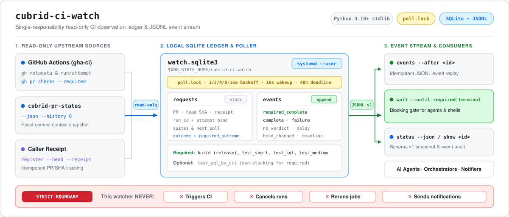

<div align="center">

<picture>
  <source media="(prefers-color-scheme: dark)" srcset="assets/readme/hero-dark.svg">
  <source media="(prefers-color-scheme: light)" srcset="assets/readme/hero-light.svg">
  
</picture>

# cubrid-ci-watch

Track caller-identified CUBRID `gha-ci` requests in a local SQLite ledger while you work. The watcher reads GitHub metadata and `cubrid-pr-status --json --history 0`. It never triggers, cancels, or reruns CI and never sends notifications.

[Why](#why-this-exists) · [Requirements](#requirements) · [Installation](#installation) · [Commands](#commands) · [Poller Service](#background-poller-service-linux--systemd) · [State & Compatibility](#state--compatibility) · [Exit Codes](#exit-codes) · [Environment](#environment-variables) · [Testing](#testing)

</div>

---

## Why This Exists

Separating **observation** from **execution and notification** keeps CI automation composable, idempotent, and safe for both shell pipelines and autonomous AI agents. Instead of embedding polling loops or side effects inside trigger scripts or notifiers, `cubrid-ci-watch` maintains one local source of truth and exposes machine-readable streams downstream.

| Component | Responsibility |
| --- | --- |
| **Read-only SQLite ledger** | Persists tracked requests and ordered events in `watch.sqlite3` (`requests` and `events` tables), serialized across processes by `poll.lock`. |
| **Composable JSONL event stream** | Supports idempotent `events --after` replay and blocking `wait --until required\|terminal` gates for AI agents, orchestrators, and notifiers. |
| **`systemd --user` background poller** | Runs a shared single-writer daemon with `1/2/4/8/16m` per-PR exponential backoff, `10s` wakeup checks, and a `48h` request deadline. |
| **Required vs. optional suite gating** | Emits `required_complete` to unblock workflows as soon as required checks finish—without waiting on optional suites such as `test_sql_by_cci`—while `complete` still records full terminal outcomes. |

## Requirements

- **Python 3.10+** (standard library only; zero runtime PyPI dependencies)
- **`gh`** authenticated for GitHub API access
- **`cubrid-pr-status`** on `PATH` (or via `~/my-cubrid/bin/cubrid-pr-status` or `CUBRID_CI_WATCH_SNAPSHOT`)

## Installation

Install or refresh the global `cubrid-ci-watch` command with `just` and `uv`:

```sh
just install   # alias for `just sync` (used by daily-update-cubrid)
just doctor    # verify installed binary path and snapshot provider
just status    # show poller status and active tracked requests (passes extra flags)
```

For local development where edits take effect immediately:

```sh
just install-editable
```

## Commands

### Inspect & Query

```sh
# Concise human view: poller status + active requests (newest first)
cubrid-ci-watch status
cubrid-ci-watch ls

# Filter or inspect historical requests
cubrid-ci-watch status --recent 10
cubrid-ci-watch status --pr 8514 --all
cubrid-ci-watch status --closed --outcome failure -v
cubrid-ci-watch status --plain

# Machine-readable JSON snapshot (unfiltered returns all requests for compatibility)
cubrid-ci-watch status --json
cubrid-ci-watch status --active --json

# Inspect one request in detail (contexts, attribution, latest events)
cubrid-ci-watch show 87
cubrid-ci-watch show 87 --all-events
cubrid-ci-watch show 87 --json
```

### Register & Scope

```sh
# Register a trigger receipt, then attach verified run/attempt binding
cubrid-ci-watch register 1234 --head "$HEAD_SHA" --suite shell --suite sql \
  --triggered-at "$TRIGGERED_AT" --receipt "$COMMENT_URL"
cubrid-ci-watch register 1234 --head "$HEAD_SHA" --required-only \
  --triggered-at "$TRIGGERED_AT" --receipt "$COMMENT_URL"
cubrid-ci-watch register 1234 --head "$HEAD_SHA" --suite shell --suite sql \
  --triggered-at "$TRIGGERED_AT" --receipt "$COMMENT_URL" --run-id 123 --attempt 1

# Drop an optional suite from an active request so it no longer gates completion
cubrid-ci-watch drop-suite 87 --suite sql_by_cci
```

### Poll

```sh
# Run the shared poller (default: 1/2/4/8/16m per-PR backoff, 48h deadline, 10s wakeup)
cubrid-ci-watch poll
cubrid-ci-watch poll --wakeup 10
cubrid-ci-watch poll --interval 900       # fixed interval override
cubrid-ci-watch poll --once
cubrid-ci-watch poll --once --force
```

### Stream & Wait

```sh
# Replay JSONL events or wait inside an interactive/agent session
cubrid-ci-watch events --after 42
cubrid-ci-watch events --request 87 --kind failure
cubrid-ci-watch wait 87 --after 100
cubrid-ci-watch wait 87 --after 100 --until required --timeout 3600
cubrid-ci-watch wait 87 --after 100 --until terminal --timeout 3600
```

### Maintenance

```sh
# Preview or remove old closed requests (dry-run unless --yes is passed)
cubrid-ci-watch prune --older-than 30d
cubrid-ci-watch prune --older-than 30d --keep 10 --yes
```

## Background Poller Service (Linux / systemd)

Run the poller as a `systemd --user` service (`~/.config/systemd/user/cubrid-ci-watch.service`). Prerequisites: authenticated `gh` (`gh auth login`), `cubrid-pr-status`, `gh-pr-info` on `PATH`, and user linger (`loginctl enable-linger $USER`) if using `autostart enable`.

```sh
just install   # install or refresh cubrid-ci-watch via uv
just setup     # write and verify systemd unit (--wakeup 10, per-PR 1/2/4/8/16m backoff)
just doctor    # verify CLI, snapshot provider, gh auth, gh-pr-info, and unit
just up        # start cubrid-ci-watch.service
just status    # inspect service state and active tracked requests
just logs      # follow journalctl logs
just down      # stop cubrid-ci-watch.service
just restart   # restart cubrid-ci-watch.service
just serve     # run poller in the foreground
just autostart enable   # enable boot autostart (requires user linger)
just autostart disable  # disable boot autostart without stopping now
```

Ledger state lives in `$XDG_STATE_HOME/cubrid-ci-watch` (`~/.local/state/cubrid-ci-watch/watch.sqlite3`).

## State & Compatibility

- **State directory override**: Default state directory is `$XDG_STATE_HOME/cubrid-ci-watch` (or `~/.local/state/cubrid-ci-watch`). Pass `--state-dir PATH` before or after the subcommand to override.
- **Ledger & lock compatibility**: SQLite schema (`requests` and `events` tables in `watch.sqlite3`) and `poll.lock` semantics are preserved for `my-cubrid-hermes` and existing ledgers.
- **Required vs. optional contexts**: `build (release)`, `test_shell`, `test_sql`, and `test_medium` form the stable required set, unioned with live `gh pr checks --required` when available (cached across transient errors). Optional contexts (such as `test_sql_by_cci`, and `build (debug)` when not in live required checks) do not block `required_complete` or `wait --until required`; `complete` still records both overall `outcome` and `required_outcome` once all tracked contexts finish.
- **JSON vs. human output contract**: `status --json` without explicit filters returns `{"schema_version": 1, "requests": [...]}` with all requests ordered by `id ASC` to preserve existing consumers. Human `status` (and `--plain`) defaults to `active` requests only, newest first.

## Exit Codes

| Code | Meaning |
| --- | --- |
| `0` | Command succeeded (or `wait` observed a matching event or an already-closed request). CI failures are recorded in state and events, not exit codes. |
| `2` | Invalid usage, conflicting registration, unknown request ID, competing poller, storage error, or `poll --once` observation error. |
| `3` | `wait --timeout` elapsed before a matching event or closure. |

## Environment Variables

| Variable | Purpose |
| --- | --- |
| `XDG_STATE_HOME` | Base directory for `cubrid-ci-watch/watch.sqlite3`. |
| `CUBRID_CI_WATCH_SNAPSHOT` | Override path to `cubrid-pr-status`. |
| `CUBRID_CI_WATCH_GH` | Override path to `gh`. |
| `NO_COLOR`, `FORCE_COLOR`, `TERM` | Standard terminal color controls (or pass `--no-color`). |

## Testing

```sh
just test
just check
```
